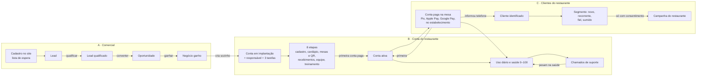

# CRM da Tipe: as três camadas ligadas

O CRM deixou de ser só um funil de vendas. Agora ele acompanha o restaurante do primeiro
cadastro no site até o cliente que paga a conta na mesa, em três camadas que conversam entre si.

| Camada | Quem usa | Pergunta que responde | Telas |
|---|---|---|---|
| **A. Comercial** | Vendas e SDR | Quem quer a Tipe e em que pé está a negociação? | Painel comercial, Leads, Oportunidades, Contatos, Empresas, Funis |
| **B. Conta do restaurante** | Sucesso do cliente | O restaurante foi implantado, está usando e está saudável? | Contas (carteira e implantação), detalhe da conta, Suporte |
| **C. Clientes do restaurante** | Restaurante, com apoio da Tipe | Quem paga a conta, volta, dá gorjeta e avalia? | Clientes (lista, perfil, campanhas, hábitos) |

A tela **Visão geral → Jornada integrada** (`/crm/jornada`) mostra as três camadas com contagens
ao vivo, o rastro completo de qualquer conta e a tabela do que já está ligado à plataforma.

## Mapa do processo



### O que acontece em cada passagem

1. **Site → lead.** O cadastro da lista de espera (`restaurant_leads`) entra como lead com origem
   "Site (lista de espera)" e vai para o vendedor ou gestor com menos leads abertos. Na
   demonstração, o botão "Simular cadastro no site" faz isso.
2. **Negócio ganho → conta.** Ao mover uma oportunidade para Ganho, o motor cria a conta do
   restaurante em implantação, com a etapa "Contrato assinado" já concluída, plano e mesas
   sugeridos pelo número de mesas do lead, PDV informado na empresa e o responsável de sucesso
   com menos contas do departamento "Sucesso". Cria também três tarefas (kickoff amanhã, cardápio
   e mesas em 3 dias, treinamento em 7) e avisa o responsável. Se a empresa já tem conta, ela é
   reaproveitada. Reabrir o negócio antes de a implantação começar desfaz a conta e as tarefas
   pendentes; depois disso, o responsável é avisado.
3. **Implantação → conta ativa.** São 8 etapas. "Recebimentos ativos" só pode ser concluída com a
   conta de recebimento aprovada. "Primeira conta paga" é marcada sozinha. Com as 8 prontas, a conta
   vira **Ativa** e o gestor é avisado.
4. **Conta paga → uso e cliente.** Cada conta paga pela Tipe gera uma visita (mesa, garçom, forma
   de pagamento, gorjeta extra paga depois da conta, avaliação, itens). Quem informa o telefone
   vira cliente do restaurante. Só ficam visíveis os 4 últimos dígitos.
5. **Uso → saúde.** A nota de 0 a 100 usa só fatos: tendência de uso em 14 dias (até 40),
   avaliação média (25), chamados abertos (20) e dias com movimento na semana (15). Saudável a
   partir de 70, Atenção de 45 a 69, Em risco abaixo. O painel lista as contas que pedem atenção.
6. **Cliente → campanha.** Campanhas alcançam só quem aceitou receber mensagens (LGPD). Sem
   público com consentimento, a campanha não é criada.

## Arquitetura

```
src/lib/tipe/crm/
  types.ts           tipos: Lead, Deal, RestaurantAccount, Consumer, Visit, Campaign…
  permissions.ts     papéis × ações (accounts.manage, consumers.view, campaigns.manage)
  engine.ts          dispatch(state, comando): o ÚNICO caminho de escrita, com validação e auditoria
  ecosystem.ts       leituras puras: progresso, saúde, uso, segmentos, jornada, contagens
  seed.ts            dados fictícios da demonstração (SEED_VERSION 2)
  seed-ecosystem.ts  contas, visitas, clientes e campanhas fictícios ligados aos negócios ganhos
  adapters.ts        conversão dos dados reais do Supabase para o CRM + INTEGRATION_POINTS
  store.ts           estado no navegador (localStorage) no modo demonstração
src/components/tipe/crm/
  Shell.tsx          logo oficial, navegação em pílula por camada, busca, ações rápidas
  eco.tsx            peças visuais das camadas (LayerTag, Gauge, HealthPill, JourneyTimeline)
src/routes/crm.*.tsx telas (painel, jornada, contas, contas/$id, clientes, suporte…)
docs/crm/supabase-crm.sql  esquema proposto com RLS (não aplicado)
```

O motor é puro: recebe o estado e um comando e devolve o novo estado. A mesma regra deve rodar
no servidor quando o CRM sair do modo demonstração (funções do Supabase ou Workers da Cloudflare
repetindo `engine.ts`). As telas só leem por `useOrgData()`, que filtra pela organização atual.

### Ligações entre os registros

| De | Para | Campo |
|---|---|---|
| Lead | Oportunidade | `deal.leadId` |
| Oportunidade | Conta | `account.dealId`, `account.leadId`, `account.companyId`, `account.contactId` |
| Empresa | Conta | `accountOfCompany()` (a ficha da empresa mostra "Já é cliente da Tipe") |
| Conta | Tarefas e chamados | `task.accountId`, `ticket.accountId` |
| Conta | Restaurante real | `account.platformRestaurantId` → `restaurants.id` |
| Conta | Visitas e clientes | `visit.accountId`, `consumer.accountId` |
| Visita | Pagamento real | `visitFromPayment()` lê `table_payment_requests` aprovados |

## O que funciona e o que depende de módulo externo

| Camada | Item | Situação | Observação |
|---|---|---|---|
| A | Lead → oportunidade → ganho → conta | **Funciona** | Fluxo completo no motor, com testes |
| B | Implantação, módulos, plano, status, responsável | **Funciona** | Regras de plano (totens no Profissional, KDS no Premium) |
| B | Saúde, contas em risco, chamados por restaurante | **Funciona** | Chamado de restaurante avisa o responsável e pesa na nota |
| C | Segmentos, perfil do cliente, campanhas com consentimento | **Funciona** | Campanha registrada como "simulada", sem envio |
| A | Leads do site | Adaptador pronto | `leadFromWaitlist()`; falta o job que importa `restaurant_leads` |
| B | Cadastro, plano e mesas reais | Adaptador pronto | `accountFromPlatform()` lê `restaurants`, `restaurant_subscriptions`, `restaurant_tables` |
| B | PDV e recebimentos reais | Adaptador pronto | `restaurants.pos_mode` e `onboarding_step` |
| B | Uso real da conta | Adaptador pronto | `visitFromPayment()` e a view `crm_account_usage_daily` no SQL |
| A | WhatsApp comercial | Depende | Credenciais da Meta (Cloud API) |
| C | Histórico do cliente final | Depende | O pagamento hoje guarda só o nome; precisa de telefone e consentimento na conta da mesa |
| C | Envio real de campanhas | Depende | Número do restaurante na Cloud API e modelos aprovados pela Meta |
| Todas | Dados persistidos no servidor | Depende | Aplicar `docs/crm/supabase-crm.sql` no Supabase de destino e trocar o `store.ts` |

## Formas de pagamento

O CRM usa as mesmas formas da conta na mesa: **Pix, Apple Pay, Google Pay e pagar no
estabelecimento**. Não existe cartão digitado na conta. Uma conta de restaurante precisa manter
pelo menos uma delas ligada. A gorjeta extra é um segundo pagamento, depois da conta.

## Visual

Tema claro com as cores oficiais (turquesa `#0FC9BD` e azul-marinho `#021E34`), logo oficial
vetorizado sem redesenho (`src/assets/marca/`, funciona fora do Lovable), navegação em pílula por
camada, números grandes com selos de variação verde e vermelho, medidor de saúde, cartão de
destaque turquesa, mapa por bairro, barras hachuradas para o comercial e faixa da semana com o
cartão "Hoje" em azul-marinho. Cada camada tem uma cor fixa: A azul-marinho, B turquesa, C laranja.
